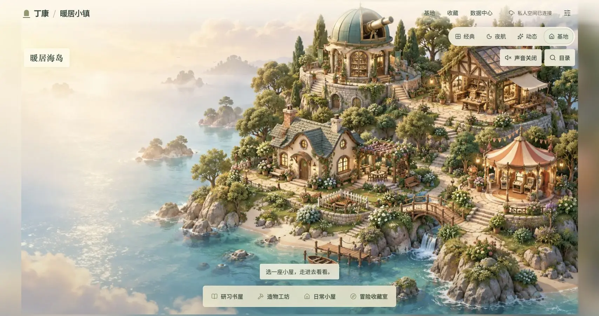
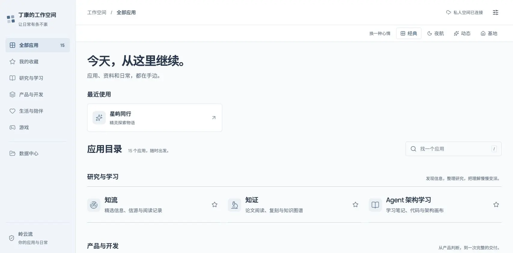
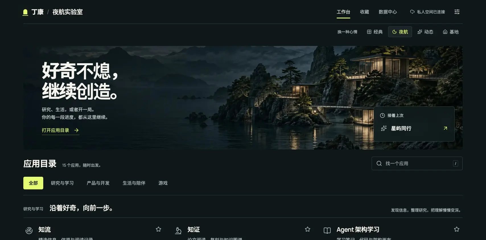
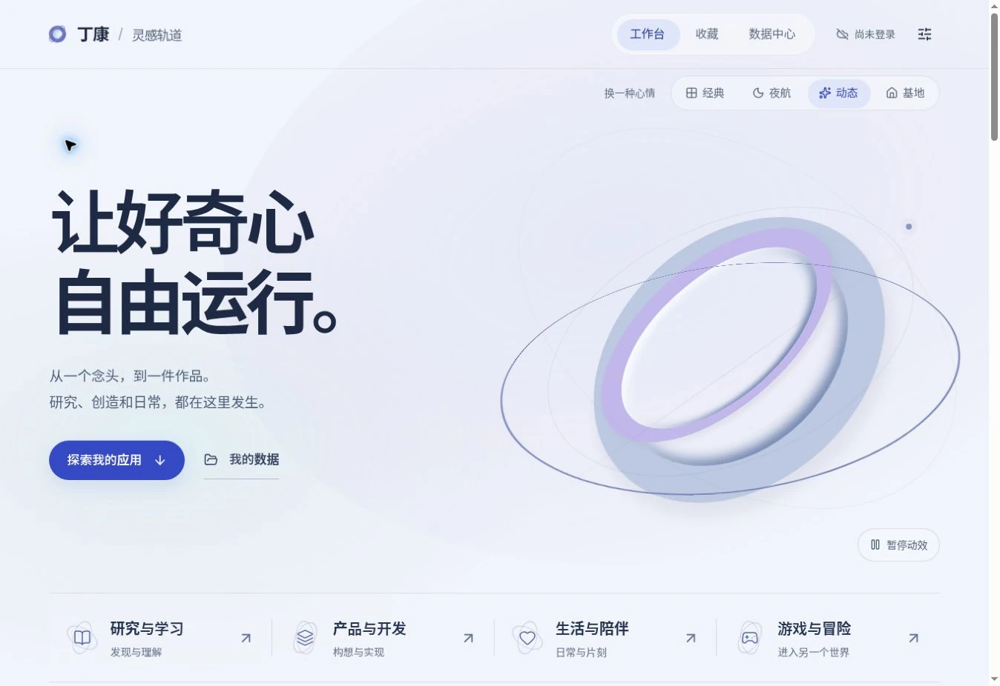
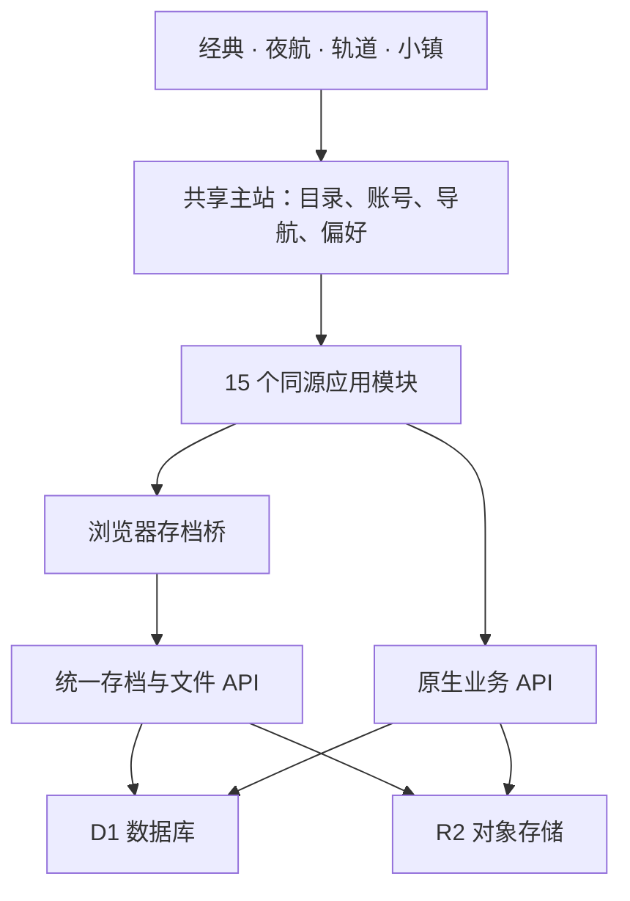

<div align="center">

# 丁康的工作空间

### 研究、创造、生活与冒险，在同一处继续。

**15 个应用 · 7 个游戏 · 4 种外观 · 统一账号与持久存储**

[经典工作台](https://dingkang-hub.dingikang.chatgpt.site/?style=classic) · [夜航实验室](https://dingkang-hub.dingikang.chatgpt.site/?style=night-harbor) · [灵感轨道](https://dingkang-hub.dingikang.chatgpt.site/?style=kinetic) · [暖居小镇](https://dingkang-hub.dingikang.chatgpt.site/?style=cozy)

[应用目录](#应用目录) · [架构](#一处修改四种外观共同生效) · [本地运行](#本地运行) · [维护文档](#维护约定与文档)

</div>

[](https://dingkang-hub.dingikang.chatgpt.site/?style=cozy)

这是一个把独立站点整合为个人工作空间的完整项目。信息雷达、论文研究、产品开发、日常陪伴与七段游戏旅程，共用一个入口、一套账号与一组存储资源。各模块保留自己的功能与界面，可以搜索、收藏、继续最近使用的应用，也可以在数据中心管理文件和存档。

**源码公开，线上空间保持私人访问。** 上面的预览链接需要站点授权登录；截图可直接查看。仓库不包含用户数据库、私人附件、迁移快照或服务凭据。

## 四种外观，同一份工作空间

| 经典工作台 · `classic` | 夜航实验室 · `night-harbor` |
|---|---|
| [](https://dingkang-hub.dingikang.chatgpt.site/?style=classic) | [](https://dingkang-hub.dingikang.chatgpt.site/?style=night-harbor) |
| 清晰的侧栏与应用目录，适合专注处理日常。 | 山海夜色与暖灯，给工作留一点安静。 |

| 灵感轨道 · `kinetic` | 暖居小镇 · `cozy` |
|---|---|
| [](https://dingkang-hub.dingikang.chatgpt.site/?style=kinetic) | [](https://dingkang-hub.dingikang.chatgpt.site/?style=cozy) |
| 冷白空间中的银蓝形体、流动背景与整页交互，让灵感一路延伸到应用。 | 暖阳海岛、细腻小屋与风云水光；选中建筑，进入房间，触碰物件打开应用。 |

**灵感轨道**让动态贯穿整个工作空间：主视觉随滚动融入页面边缘，导航滑块跟随选择，研究与产品入口轻轻运转，应用封面响应指针。主视觉由代码实时绘制，无需新增生成图片；支持 WebGL 的设备使用立体金属丝带，不支持时保留轻量动态画面。上方截图展示后者。首屏可直接暂停动效，系统减少动效、页面隐藏或打开应用时也会停止持续运动。设计与验证范围见 [整页动态设计](docs/design/kinetic-motion.md)。

四种外观可以直接切换，已打开的应用保持挂载，游戏与工作内容不因换主题而重载。暖居采用**高精度烘焙美术与实时 WebGL 局部动态结合的固定视角 2.5D 场景**：保留木纹、石材、玻璃和织物的细节，让海水、薄云、微风与灯光在各自区域轻轻变化。镜头提供有限视差与横向观察，不提供任意角度自由漫游。环境音默认关闭，由用户主动开启；页面隐藏或离开场景时暂停声音与动态，动效遵循系统减少动效设置。WebGL 不可用时仍可从辅助清单使用应用。

## 把应用，安放进房间里

[](https://dingkang-hub.dingikang.chatgpt.site/?style=cozy)

上图为游戏中使用的室内环境美术；海岛与四种外观展示使用实际页面截图。选中轮廓、物件标签与动态效果请在站点中体验。

推开研习书屋的门，知流是窗边的星象仪，知证是桌上的研究手稿，Agent 架构学习成为墙上的架构图。走进冒险收藏室，精灵玻璃花园、战争沙盘、邮船和山水卷轴各自通向一段游戏旅程。

| 房间 | 应用物件 | 空间里的入口 |
|---|---:|---|
| 研习书屋 | 3 | 星象仪、研究手稿、架构图 |
| 造物工坊 | 3 | 灵感画架、演进齿轮、开发工作台 |
| 日常小屋 | 2 | 晚灯、钥匙架 |
| 冒险收藏室 | 7 | 风景画、玻璃花园、街机、沙盘、邮船、卷轴、将旗 |

先在岛上选中建筑，查看暖金轮廓与房间名称，再确认进入。房间内的墙画、玻璃花园、落地灯和桌上手稿都按实际画面标注点击范围，悬停可辨认对应应用。窄屏可横向观察并聚焦物件，也可直接使用“房间物件”清单；“列表与搜索”默认收起，需要时再展开。退出应用仍先等待存档保存，成功后回到本次会话中的原房间；刷新页面回到基地总览。

所有物件调用同一个应用打开流程，继续使用同一套账号、API 和存档。完整物件对应关系与控制说明见 [暖居海岛与房间](docs/cozy-base.md)。室内素材使用内置图像生成工具制作，后续美术沿用 [场景美术规范](docs/design/cozy-art-direction.md) 与 [实际生成提示词](docs/design/cozy-room-art-prompts.md)。

## 应用目录

| 分类 | 应用 | 用途 |
|---|---|---|
| 研究与学习 | [知流](https://dingkang-hub.dingikang.chatgpt.site/?app=zhiliu-radar) | 个人信息雷达：信源、报道、事件与阅读记录 |
| 研究与学习 | [知证](https://dingkang-hub.dingikang.chatgpt.site/?app=zhizheng-research) | 论文研究工作台：阅读、复刻、项目与知识整理 |
| 研究与学习 | [Agent 架构学习](https://dingkang-hub.dingikang.chatgpt.site/?app=agent-architecture-journey) | 学习笔记、示例代码与架构实践 |
| 产品与开发 | [AI PM Studio](https://dingkang-hub.dingikang.chatgpt.site/?app=aipm-studio-dk) | 产品构想、问题发现与验证 |
| 产品与开发 | [EvoPM](https://dingkang-hub.dingikang.chatgpt.site/?app=evopm-workbench) | 反馈分析、需求决策与产品演进 |
| 产品与开发 | [AI 研发协作](https://dingkang-hub.dingikang.chatgpt.site/?app=ai-dev-collaboration-workbench) | 需求、执行、交付与验收，承接造物流程 |
| 生活与陪伴 | [晚灯](https://dingkang-hub.dingikang.chatgpt.site/?app=wandeng-evening) | 数字陪伴、对话与轻复盘 |
| 生活与陪伴 | [同住](https://dingkang-hub.dingikang.chatgpt.site/?app=roommate-housekeeper) | 合租账单、家务和共同日常；保留原演示家庭模式 |
| 游戏 | [逐风奇旅](https://dingkang-hub.dingikang.chatgpt.site/?app=cloudrush-runner) | 跑者、坐骑与浮空岛 |
| 游戏 | [星屿同行](https://dingkang-hub.dingikang.chatgpt.site/?app=starfall-creature-isles) | 精灵伙伴与群岛探索 |
| 游戏 | [口袋游乐场](https://dingkang-hub.dingikang.chatgpt.site/?app=pocket-arcade-ten) | 小游戏合集与灰烬远征 |
| 游戏 | [YourWar](https://dingkang-hub.dingikang.chatgpt.site/?app=yourwar-battle-forge) | 自由布阵的战争沙盘 |
| 游戏 | [雾海来信](https://dingkang-hub.dingikang.chatgpt.site/?app=mistbound-letters) | 邮船、群岛与故事 |
| 游戏 | [月下问仙录](https://dingkang-hub.dingikang.chatgpt.site/?app=moonlit-immortal-chronicle) | 奇遇、宗门与文字修仙 |
| 游戏 | [云阙三国](https://dingkang-hub.dingikang.chatgpt.site/?app=yunque-sanguo) | 武将招募、阵容与关卡 |

应用目录的唯一数据源是 [`lib/hub/catalog.ts`](lib/hub/catalog.ts)。游戏货币、角色、关卡和业务项目保持模块独立，不做跨应用混合。

## 一处修改，四种外观共同生效

主题负责呈现，主站负责导航与操作，模块负责各自业务。新增应用、修复存档或调整导入流程，均在共享实现中完成，四种外观直接复用。



| 共享职责 | 代码入口 |
|---|---|
| 应用目录与分类 | [`lib/hub/catalog.ts`](lib/hub/catalog.ts) |
| 主题定义、URL 与场景接口 | [`lib/hub/theme.ts`](lib/hub/theme.ts) |
| 导航、收藏、导入与账号状态 | [`app/page.tsx`](app/page.tsx) |
| 灵感轨道的整页背景与交互动态 | [`components/KineticBackdrop.tsx`](components/KineticBackdrop.tsx) · [`lib/hub/kinetic-motion.ts`](lib/hub/kinetic-motion.ts) · [`app/kinetic.css`](app/kinetic.css) |
| 暖居场景、房间热点与局部动态 | [`components/`](components/) · [`lib/hub/cozy-scene.ts`](lib/hub/cozy-scene.ts) · [`lib/hub/cozy-room-art.ts`](lib/hub/cozy-room-art.ts) · [`lib/hub/cozy-atmosphere.ts`](lib/hub/cozy-atmosphere.ts) |
| 云存档桥与模块启动等待 | [`public/hub-storage.js`](public/hub-storage.js) · [`components/ModuleStorageGate.tsx`](components/ModuleStorageGate.tsx) |
| 保存状态、冲突与本机恢复副本 | [`components/HubStoragePanel.tsx`](components/HubStoragePanel.tsx) |
| 统一 API 与版本检查 | [`lib/hub/server.ts`](lib/hub/server.ts) · [`app/api/hub/`](app/api/hub/) |
| 模块业务实现与 API | [`modules/`](modules/) · [`app/api/m/`](app/api/m/) |

原生页面走 `/m/<module>`，静态应用走 `/apps/<module>`，业务 API 走 `/api/m/<module>`。主站使用同源 iframe 隔离样式、DOM 和模块实例；它们实际运行在统一站点中。

## 数据如何保存

一个 Worker 共用一个 D1 `DB` 和一个 R2 `BUCKET`。D1 包含 **33 张原生业务表 + 3 张统一存储表**；表前缀和账号字段负责隔离。R2 使用用户与模块前缀区分数据中心文件和研究附件。

- **账号归属**：服务端只接受部署平台验证的身份；浏览器提交的用户 ID 不能决定数据归属。
- **游戏与偏好**：保留原存档键和内容，通过统一桥同步到 `hub_states`。页面等待恢复完成后再启动。
- **写入冲突**：使用版本比较与交换，过期写入返回冲突；最近 20 个历史版本保留在 `hub_state_versions`。
- **离线与恢复**：显示实际保存状态，保留待同步内容。采用云端副本前先保存本机恢复副本；离开模块前等待待提交的存档。
- **业务记录**：研究项目、对话、产品工作区等继续由各模块原生 API 保存。
- **附件**：数据中心支持单文件最大 25 MiB，下载须验证归属；文件不以公开 HTML 页面执行。

数据中心的“导出存档”只包含当前账号的统一存档与偏好，**不包含原生业务数据库、附件或历史版本**。完整备份需要分别处理 D1 与 R2。旧域名浏览器存档需要先导出再导入，不能跨域自动读取；一个游戏通过迁移验收也不代表全部旧设备的存档已迁入。详见 [存储说明](docs/unification.md) 和 [迁移流程](docs/migration-2026-10-23.md)。

## 本地运行

技术栈：**React 19 · TypeScript · Vinext / Vite · Cloudflare Workers · D1 / Drizzle · R2 · Three.js**。

需要 Node.js **22.13.0 或更高版本**、Git，以及仓库固定的 **pnpm 11.25.0**。使用已提交的 `pnpm-lock.yaml`，不要另起一份依赖锁文件。

```sh
git clone https://github.com/Adversit/dingkang.git
cd dingkang
pnpm install --frozen-lockfile
pnpm run build
```

大体积静态资源随仓库保存在 `asset-pack/`：14 份不同资源还原到 15 个应用路径，共用素材复用同一套分片。`dev` 和 `build` 会离线校验、自动还原，不需要外部下载；也可运行 `pnpm assets:restore`。已有资源如被手动修改，还原会停止并保留修改。确认要更新资源时，运行 `pnpm assets:pack`，将新的 manifest 与分片一并提交；原始大文件保持忽略。`start` 直接使用已构建的 `dist`。

首次本地运行需初始化 D1。构建会生成 `dist/server/wrangler.json`；对全新的本地数据库执行：

```sh
node --import ./scripts/sites-env.mjs ./node_modules/wrangler/bin/wrangler.js d1 execute DB --local --config dist/server/wrangler.json --persist-to .wrangler/state --file drizzle/0000_sad_lucky_pierre.sql
pnpm run dev
```

默认开发入口为 `http://localhost:5173`，以终端实际输出为准。干净检出使用 portable 执行配置；在本机回环开发环境，可通过 `/signin-with-chatgpt?return_to=/` 使用本地测试身份。托管环境的身份由平台提供，本地模拟不会进入生产构建。已应用的迁移不要重复执行；新表结构变更通过 `pnpm run db:generate` 生成后审查 SQL。

查看构建后的 Worker：

```sh
pnpm run start
```

该命令只启动本地预览，不会发布。AI 或外部服务功能需要各模块对应的服务端环境配置；仓库不自带密钥，合并站点也不会自动启用这些服务。

## 测试与部署

从项目根目录运行：

```sh
pnpm exec tsc --noEmit --pretty false
node --test tests/*.test.mjs lib/hub/*.test.mjs
pnpm run build
```

共享测试覆盖身份、存档、版本冲突、备份导入、主题导航及房间返回；场景验证还需核对 15 个物件热点与目录的一一对应、资源路径和拾取范围。发布时另行检查四种外观的桌面与 375px 移动布局、建筑选中与进入、物件实际点击、窄屏观察、音效开关，以及应用打开期间切换主题不重载。具体模块保留各自的测试文件；静态数据和几何检查不能替代实际浏览器验收。新版场景的上线结论以部署结果与浏览器验收为准。

生产部署使用 Sites 的源码发布流程：

1. 保留 `.openai/hosting.json` 的现有站点标识、`DB` / `BUCKET` 绑定和私人访问设置。
2. 完成测试，审查数据库迁移，将锁文件、源码、静态资源和迁移文件一并交给发布流程。
3. 在托管环境配置所需服务凭据，不写入源码、截图、日志或提交历史。
4. 发布后等平台报告成功，再检查登录、D1/R2 健康状态和真实模块读写。

`pnpm run build` 只生成部署产物。直接运行一个未配置可信身份入口的 Worker，不等同于完整的 Sites 部署。平台项目 ID 是部署关联标识，应保留；凭据、运行数据库与用户导出文件不得提交。

## 项目目录

| 路径 | 内容 |
|---|---|
| `app/` | 主站、模块页面、认证辅助与 API 路由 |
| `components/` | 四种外观的共享组件、场景与存档面板 |
| `lib/hub/` | 目录、主题、存储、导入转换与迁移控制 |
| `modules/` | 各应用保留的业务源码、结构与模块测试 |
| `public/apps/` | 静态应用及游戏入口 |
| `public/assets/` | 按模块划分的图片、字体、音频与样式 |
| `asset-pack/` | 大资源的离线分片与 SHA-256 校验清单 |
| `db/`、`drizzle/` | 汇总数据库结构与版本化迁移 |
| `tests/` | 存档、备份导入、主题和集成测试 |
| `worker/`、`scripts/` | Worker 入口和开发、构建工具 |
| `docs/` | 架构、迁移、存档说明与实际截图 |

## 维护约定与文档

后续开发以 [Adversit/dingkang](https://github.com/Adversit/dingkang) 为唯一源码仓库。先阅读 [AGENTS.md](AGENTS.md)：应用只登记一次，业务接口和存档格式只维护一套；场景通过回调使用共享操作。切换外观保留模块实例，离开模块先处理未完成的保存。

- [统一站点与存储说明](docs/unification.md)
- [统一存储 API](lib/hub/README.md)
- [暖居海岛、房间与应用物件](docs/cozy-base.md)
- [灵感轨道整页动态设计与验证范围](docs/design/kinetic-motion.md)
- [场景美术规范与提示词模板](docs/design/cozy-art-direction.md) · [室内实际生成提示词](docs/design/cozy-room-art-prompts.md)
- [本轮验证记录与待复核项](docs/verification-2026-10-24.md)
- [存档面板与离开保护](docs/storage-panel.md)
- [迁移流程与验收](docs/migration-2026-10-23.md) · [游戏存档兼容](docs/game-migration.md)
- [研究模块](docs/research-migration.md) · [产品模块](docs/product-migration.md) · [生活与学习模块](docs/personal-migration.md)
- [设计说明](DESIGN.md)

---

<div align="center">

**自己的空间，自己的节奏。**

</div>
